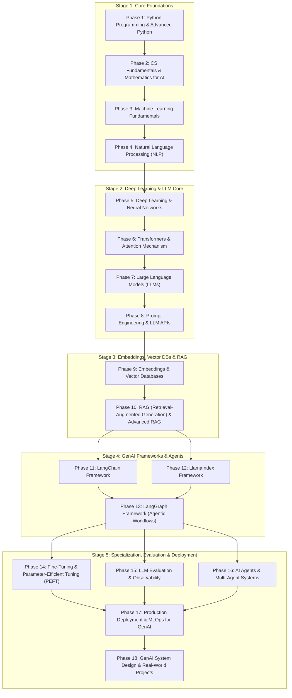
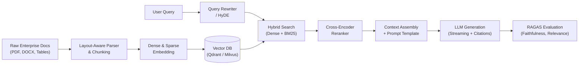
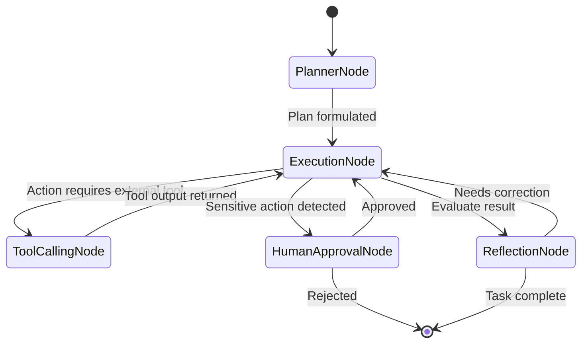
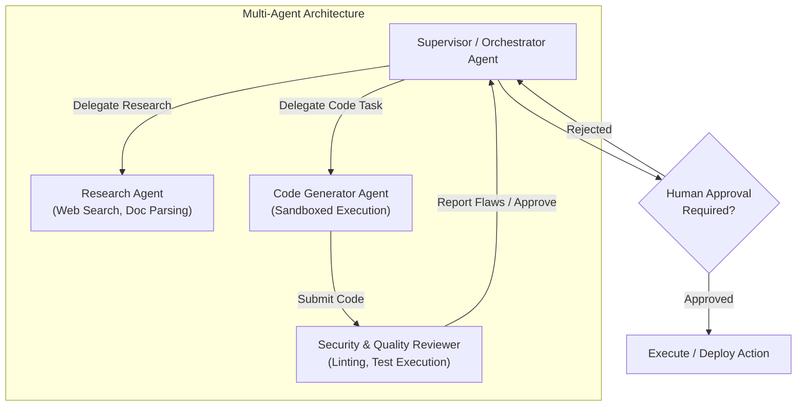

# Complete Python Generative AI Engineer Roadmap: Beginner to Advanced
> **Mastery Pathway: Theory → Core Implementation → Enterprise Frameworks → Production MLOps & System Design**

---

## 🗺️ Roadmap Flow & Architecture



---

## 📚 Table of Contents

1. [Phase 1: Python Programming (Foundation)](#phase-1-python-programming-foundation)
2. [Phase 2: Computer Science & Mathematics](#phase-2-computer-science--mathematics)
3. [Phase 3: Machine Learning Fundamentals](#phase-3-machine-learning-fundamentals)
4. [Phase 4: Natural Language Processing (NLP)](#phase-4-natural-language-processing-nlp)
5. [Phase 5: Deep Learning & Neural Networks](#phase-5-deep-learning--neural-networks)
6. [Phase 6: Transformers & Attention Mechanism](#phase-6-transformers--attention-mechanism)
7. [Phase 7: Large Language Models (LLMs)](#phase-7-large-language-models-llms)
8. [Phase 8: Prompt Engineering & LLM APIs](#phase-8-prompt-engineering--llm-apis)
9. [Phase 9: Embeddings & Vector Databases](#phase-9-embeddings--vector-databases)
10. [Phase 10: Retrieval-Augmented Generation (RAG) & Advanced RAG](#phase-10-retrieval-augmented-generation-rag--advanced-rag)
11. [Phase 11: LangChain Framework](#phase-11-langchain-framework)
12. [Phase 12: LlamaIndex Framework](#phase-12-llamaindex-framework)
13. [Phase 13: LangGraph Framework (Agentic AI)](#phase-13-langgraph-framework-agentic-ai)
14. [Phase 14: Fine-Tuning & Model Training](#phase-14-fine-tuning--model-training)
15. [Phase 15: LLM Evaluation & Observability](#phase-15-llm-evaluation--observability)
16. [Phase 16: AI Agents & Multi-Agent Systems](#phase-16-ai-agents--multi-agent-systems)
17. [Phase 17: Production Deployment & GenAI Engineering](#phase-17-production-deployment--genai-engineering)
18. [Phase 18: Generative AI System Design](#phase-18-generative-ai-system-design)
19. [Phase 19: Progressive Real-World Portfolio Projects](#phase-19-progressive-real-world-portfolio-projects)
20. [Interview Preparation Checklist & Strategy](#interview-preparation-checklist--strategy)

---

## Phase 1: Python Programming (Foundation)

Before building LLMs and RAG pipelines, you must master Python cleanly: write performant asynchronous code, design idiomatic object-oriented systems, and process high-throughput data streams.

### 1. Python Fundamentals
- [ ] What is Python & How CPython executes code
- [ ] Features, dynamic typing, and interpreted nature of Python
- [ ] Python installation, virtual environments (`venv`, `uv`, `poetry`, `conda`)
- [ ] Variables, naming conventions, and constants
- [ ] Core data types: `int`, `float`, `complex`, `str`, `bool`, `NoneType`, `bytes`
- [ ] Type casting and explicit vs implicit type conversion
- [ ] Mutable vs Immutable objects (identity, `id()`, value equality vs reference equality)
- [ ] Operators: Arithmetic, Comparison, Logical, Bitwise, Identity (`is`), Membership (`in`)
- [ ] Conditional control flow: `if`, `elif`, `else`, Ternary expressions
- [ ] Iteration loops: `for`, `while`, Nested loops
- [ ] Loop control: `break`, `continue`, `pass`, `for...else` constructs
- [ ] String indexing, slicing, and common string methods (`strip`, `split`, `join`, `replace`, `find`, regex integration)
- [ ] String formatting: `%` operator, `.format()`, f-strings with format specs (`f"{val:.2f}"`, `f"{val=}"`)
- [ ] Input and output: `sys.stdin`, `print()`, file streams
- [ ] Static type hints (`typing` module: `Union`, `Optional`, `Any`, `Literal`, `Annotated`, `TypeVar`)

### 2. Python Data Structures
- [ ] Lists: Memory allocation, dynamic array characteristics, slicing `lst[start:stop:step]`
- [ ] Tuples: Immutability, hashing, named tuples (`collections.namedtuple`, `typing.NamedTuple`)
- [ ] Sets: Hash set mechanics, uniqueness, set algebra (union `|`, intersection `&`, difference `-`, symmetric difference `^`)
- [ ] Dictionaries: Hash table collisions, key hashing requirements, hash map operations
- [ ] Dictionary methods: `.get()`, `.setdefault()`, `.update()`, `.items()`, `.keys()`, `.values()`
- [ ] Nested and recursive data structures
- [ ] List comprehensions with conditional filters
- [ ] Dictionary comprehensions & Set comprehensions
- [ ] Shallow copy (`copy.copy()`) vs Deep copy (`copy.deepcopy()`)
- [ ] Asymptotic time and space complexity ($O(1)$, $O(n)$, $O(n \log n)$) of native operations (`in`, `append`, `insert`, `pop`, `sort`)

### 3. Python Functions
- [ ] Function definition, call semantics, and stack frames
- [ ] Positional vs Keyword arguments, Positional-only (`/`) and Keyword-only (`*`) parameters
- [ ] Default arguments (and the mutable default argument trap `def f(x=[])`)
- [ ] Variable argument unpacking: `*args` and `**kwargs`
- [ ] Return values, returning multiple values as tuples, early returns
- [ ] Lambda anonymous functions and single-expression constraints
- [ ] Recursion, base cases, recursion depth limit (`sys.getrecursionlimit()`)
- [ ] Scope and Resolution: LEGB rule (Local, Enclosing, Global, Built-in), `global` and `nonlocal` keywords
- [ ] Functional primitives: `map()`, `filter()`, `functools.reduce()`
- [ ] Higher-order functions accepting or returning functions
- [ ] Closures, lexically enclosed variables (`__closure__`)
- [ ] Decorators: Function decorators, parameterized decorators, preserving metadata with `functools.wraps`

### 4. Object-Oriented Programming (OOP)
- [ ] Class definitions, instantiation, and object lifecycle
- [ ] Instance constructors: `__new__` vs `__init__`
- [ ] Instance attributes vs Class-level shared attributes
- [ ] Instance methods, `@classmethod` (factory pattern), `@staticmethod` (utility)
- [ ] Single and Multiple inheritance
- [ ] Encapsulation, naming conventions (`_protected`, `__private`), name mangling
- [ ] Polymorphism: Duck typing, protocols (`typing.Protocol`), structural subtyping
- [ ] Abstraction: Abstract Base Classes (`abc.ABC`, `@abstractmethod`)
- [ ] Method overriding and calling superclass implementations (`super()`)
- [ ] Method resolution order (MRO) and C3 Linearization algorithm (`Class.__mro__`)
- [ ] Magic/Dunder methods:
  - Representation: `__repr__`, `__str__`
  - Container emulation: `__len__`, `__getitem__`, `__setitem__`, `__contains__`
  - Math & operators: `__add__`, `__eq__`, `__lt__`, `__hash__`
  - Callable objects: `__call__`
- [ ] Composition vs Inheritance (Favor composition for AI pipelines)
- [ ] Data classes (`@dataclasses.dataclass`) and immutable configurations (`frozen=True`)

### 5. Advanced Python & Concurrency
- [ ] Iterators vs Iterables (`__iter__`, `__next__`, `StopIteration`)
- [ ] Generators, `yield` expressions, and lazy memory evaluation
- [ ] Two-way generators: `.send()`, `.throw()`, `.close()`, `yield from`
- [ ] Context managers: `with` statement, `__enter__` and `__exit__`, `contextlib.contextmanager`
- [ ] Exception handling: `try`, `except`, `else`, `finally`, Exception hierarchy (`BaseException` vs `Exception`)
- [ ] Custom exceptions with structured context and error codes
- [ ] File I/O: Text vs binary modes, buffered reading, memory-mapped files (`mmap`)
- [ ] Serialized formats: `json`, `csv`, `pickle` (security caveats), `tomllib`, `yaml`
- [ ] Package architecture: `__init__.py`, relative imports, namespace packages
- [ ] CPython memory model: Reference counting, generational garbage collector (`gc` module), cyclic references
- [ ] The Global Interpreter Lock (GIL): CPU-bound vs I/O-bound bottlenecks
- [ ] Multithreading (`threading`, GIL release in C extensions / NumPy)
- [ ] Multiprocessing (`multiprocessing`, IPC, SharedMemory, process isolation)
- [ ] Asynchronous programming fundamentals:
  - Cooperative multitasking vs preemptive multitasking
  - Event loop mechanics (`asyncio.run()`, `asyncio.get_running_loop()`)
  - Coroutines: `async def`, `await`
  - Tasks, futures, concurrency with `asyncio.gather()`, `asyncio.TaskGroup`
  - Async context managers (`async with`) and async generators (`async for`, `yield`)
- [ ] Concurrent executors: `concurrent.futures.ThreadPoolExecutor` and `ProcessPoolExecutor`

### 6. Key Python Libraries for GenAI
- [ ] **NumPy**: N-dimensional arrays, vectorized operations, broadcasting, memory layouts (C-contiguous vs Fortran)
- [ ] **Pandas**: DataFrames, Series, filtering, indexing, vector aggregations, reading Parquet / CSV
- [ ] **Matplotlib / Seaborn**: Visualizing embeddings, distributions, token lengths, loss curves
- [ ] **Requests & HTTPX**: Synchronous and asynchronous HTTP clients, connection pooling, backoff retries
- [ ] **Pydantic (v2)**: Strict type validation, BaseModel, field validators, serialization, JSON schema extraction for LLM function calling
- [ ] **SQLAlchemy (v2)**: ORM, Core, connection pools, async engines, schema definitions
- [ ] **Pytest**: Unit testing, fixtures, parameterization, mocking external API calls (`pytest-asyncio`, `pytest-mock`)
- [ ] **Logging & Loguru**: Structured JSON logging, log levels, contextual tracing for AI agent runs

> 🎯 **Practical Milestone 1**: Build a production-ready asynchronous Python FastAPI service that accepts multi-format document uploads (PDF, CSV, JSON, TXT), validates schemas with Pydantic v2, extracts and standardizes tabular and text records in parallel using `asyncio` and `ProcessPoolExecutor`, and exposes REST endpoints with health checks, structured logging, and unit tests.

---

## Phase 2: Computer Science & Mathematics

Generative AI is not magic; it is linear algebra, probability, optimization, and distributed systems.

### 7. Computer Science Fundamentals
- [ ] Data structures: Dynamic arrays, singly/doubly linked lists, stacks, queues, double-ended queues (`deque`)
- [ ] Hash tables: Hash functions, collision resolution (chaining vs open addressing), amortized $O(1)$ operations
- [ ] Trees & Graphs: Binary trees, BSTs, Trie (prefix trees for tokenizers), B-Trees (databases), Directed Acyclic Graphs (DAGs for agent execution)
- [ ] Search algorithms: Binary search, Breadth-First Search (BFS), Depth-First Search (DFS), Dijkstra, $A^*$ search
- [ ] Sorting algorithms: Merge sort, Quick sort, Timsort (Python's native sort)
- [ ] Complexity analysis: Big-O, Big-$\Omega$, Big-$\Theta$, amortized complexity, memory footprint
- [ ] RESTful API architecture: Statelessness, idempotent methods, HTTP verbs (`GET`, `POST`, `PUT`, `PATCH`, `DELETE`)
- [ ] HTTP status codes: `200`, `201`, `204`, `400`, `401`, `403`, `404`, `422`, `429`, `500`, `502`, `503`, `504`
- [ ] API authentication: API Keys, Bearer tokens, OAuth2, JWT validation
- [ ] SQL & Relational Databases: Indexes (B-tree, Hash), execution plans (`EXPLAIN ANALYZE`), ACID properties, transactions, isolation levels
- [ ] Caching strategies: Cache-aside, write-through, TTL expiration, cache invalidation, Redis primitives (Strings, Hashes, Sets, Sorted Sets)

### 8. Mathematics for AI / ML
- [ ] **Linear Algebra**:
  - Scalars, vectors, matrices, and high-order tensors
  - Vector spaces, linear independence, span, basis, dimension
  - Matrix addition, transposition, matrix-vector multiplication, matrix-matrix multiplication
  - Dot product (inner product) and geometric interpretation (projection)
  - Vector magnitudes: $L_1$ norm (Manhattan), $L_2$ norm (Euclidean), $L_\infty$ norm
  - Distance metrics: Euclidean distance, Manhattan distance
  - **Cosine Similarity**: Definition $\cos(\theta) = \frac{\mathbf{u} \cdot \mathbf{v}}{\|\mathbf{u}\| \|\mathbf{v}\|}$, normalized vector dot product
  - Eigenvalues, Eigenvectors, and Singular Value Decomposition (SVD)
- [ ] **Probability & Statistics**:
  - Discrete vs continuous random variables, probability mass functions (PMF), probability density functions (PDF)
  - Mean, expectation $\mathbb{E}[X]$, median, mode, variance $\text{Var}(X)$, standard deviation $\sigma$, covariance
  - Conditional probability $P(A|B)$, independence, joint distributions
  - **Bayes' Theorem**: Prior, likelihood, posterior distribution $P(A|B) = \frac{P(B|A)P(A)}{P(B)}$
  - Common distributions: Normal (Gaussian), Uniform, Bernoulli, Binomial, Multinomial, Categorical
  - Information theory: Entropy $H(X) = -\sum p(x)\log p(x)$, Cross-Entropy, Kullback-Leibler (KL) Divergence
- [ ] **Calculus & Optimization**:
  - Functions of single and multiple variables, limits, continuity
  - Derivatives, tangent lines, rates of change
  - Partial derivatives and the Gradient vector $\nabla f$
  - Chain Rule (the mathematical engine of backpropagation)
  - Convex functions vs non-convex loss landscapes, local minima, saddle points
  - **Gradient Descent**: Standard update rule $\theta \leftarrow \theta - \eta \nabla_\theta \mathcal{L}(\theta)$
  - Loss functions: Mean Squared Error (MSE), Binary Cross-Entropy (BCE), Categorical Cross-Entropy

> 💡 **Key AI Intuition**: High-dimensional vector spaces are sparse. When you compute cosine similarity between two 1536-dimensional OpenAI embeddings or 384-dimensional BGE embeddings, you are computing the normalized inner product (dot product) of vectors on the surface of a hypersphere.

---

## Phase 3: Machine Learning Fundamentals

Before jumping into deep language models, understand empirical risk minimization, feature representations, and classical models.

### 9. Introduction to Machine Learning
- [ ] AI vs ML vs Deep Learning vs Generative AI taxonomy
- [ ] Learning paradigms:
  - Supervised Learning (labeled target $y$)
  - Unsupervised Learning (finding hidden patterns in $X$)
  - Semi-Supervised Learning & Self-Supervised Learning (pretraining basis of LLMs)
  - Reinforcement Learning (Agent, Environment, State, Action, Reward)
- [ ] Problem formulations: Binary classification, Multi-class classification, Regression, Clustering
- [ ] Dataset splits: Train, Validation (development), Test sets; Data leakage pitfalls
- [ ] Features, feature matrices, target vectors, label encodings
- [ ] Underfitting (high bias) vs Overfitting (high variance); The Bias-Variance Tradeoff
- [ ] Regularization: $L_1$ (Lasso, promotes sparsity), $L_2$ (Ridge, prevents large weights), ElasticNet
- [ ] Feature engineering: Scaling, Min-Max normalization, Standardization (Z-score: $\frac{x-\mu}{\sigma}$)
- [ ] Handling missing values, categorical encoding (One-Hot, Ordinal, Target encoding)

### 10. Important Classical ML Algorithms
- [ ] **Linear Regression**: Ordinary Least Squares (OLS), cost function, closed-form Normal Equation vs Gradient Descent
- [ ] **Logistic Regression**: Sigmoid function $\sigma(z) = \frac{1}{1 + e^{-z}}$, log-loss function, odds ratio
- [ ] **Decision Trees**: Splitting criteria (Gini Impurity, Information Gain / Shannon Entropy), tree depth, pruning
- [ ] **Random Forest**: Bagging (Bootstrap Aggregation), feature subsampling, out-of-bag (OOB) error
- [ ] **Support Vector Machines (SVM)**: Maximum margin hyperplane, support vectors, Kernel trick (RBF, Polynomial)
- [ ] **K-Nearest Neighbors (KNN)**: Lazy learner, distance metrics, curse of dimensionality (direct intuition for vector retrieval)
- [ ] **Naive Bayes**: Conditional independence assumption, text classification application
- [ ] **K-Means Clustering**: Centroid initialization, Lloyd's algorithm, Voronoi cells, Elbow method, Silhouette score
- [ ] **Principal Component Analysis (PCA)**: Dimensionality reduction, variance retention, covariance matrix decomposition
- [ ] **Gradient Boosted Decision Trees (GBDT)**: Residual learning, XGBoost, LightGBM, CatBoost fundamentals

### 11. Model Evaluation & Metrics
- [ ] Confusion Matrix: True Positives (TP), False Positives (FP), True Negatives (TN), False Negatives (FN)
- [ ] Metrics:
  - $\text{Accuracy} = \frac{TP + TN}{TP + TN + FP + FN}$ (and why it fails on imbalanced data)
  - $\text{Precision} = \frac{TP}{TP + FP}$ (quality of positive predictions)
  - $\text{Recall (Sensitivity)} = \frac{TP}{TP + FN}$ (coverage of actual positives)
  - $\text{F1-Score} = 2 \cdot \frac{\text{Precision} \cdot \text{Recall}}{\text{Precision} + \text{Recall}}$ (Harmonic mean)
- [ ] ROC (Receiver Operating Characteristic) curve, True Positive Rate vs False Positive Rate
- [ ] AUC (Area Under the ROC Curve)
- [ ] Regression evaluation: Mean Squared Error (MSE), Root Mean Squared Error (RMSE), Mean Absolute Error (MAE), $R^2$ Score
- [ ] Cross-Validation: K-Fold, Stratified K-Fold, Time-Series split

---

## Phase 4: Natural Language Processing (NLP)

NLP bridges raw strings and numerical representations. Mastering these fundamentals prevents naive errors in tokenization and chunking.

### 12. NLP Fundamentals & Pipeline
- [ ] The NLP lifecycle: Ingestion → Normalization → Tokenization → Representation → Modeling → Inference
- [ ] Sentence boundary disambiguation & Sentence segmentation
- [ ] Tokenization: Word tokenization, whitespace tokenization, character tokenization
- [ ] Text normalization: Lowercasing, accent stripping, Unicode normalization (NFC, NFD, NFKC, NFKD)
- [ ] Stopwords: Removal rationale, when to retain stopwords (e.g., question answering, semantic search)
- [ ] Punctuation handling, regex-based token cleaning
- [ ] Morphological analysis:
  - **Stemming**: Heuristic suffix stripping (Porter Stemmer, Snowball Stemmer)
  - **Lemmatization**: Dictionary-based morphological normalization using POS context (WordNet lemmatizer)
- [ ] Part-of-Speech (POS) tagging: Universal dependency tags, Penn Treebank tagset
- [ ] Named Entity Recognition (NER): Recognizing Persons, Organizations, Locations, Dates
- [ ] Chunking (shallow parsing) & Dependency parsing (subject-verb-object relationships)

### 13. Text Representation Techniques
- [ ] **One-Hot Encoding**: Sparse representation, orthogonal vectors, zero semantic similarity
- [ ] **Bag of Words (BoW)**: Word count vectors, order insensitivity
- [ ] **N-Grams**: Bi-grams, Tri-grams, capturing local phrase order
- [ ] **TF-IDF (Term Frequency - Inverse Document Frequency)**:
  $$\text{TF}(t, d) = \frac{f_{t,d}}{\sum_{t'} f_{t',d}}, \quad \text{IDF}(t, D) = \log\left(\frac{N}{|\{d \in D : t \in d\}|}\right), \quad \text{TF-IDF} = \text{TF} \times \text{IDF}$$
  - Understanding why TF-IDF remains a potent baseline for BM25 keyword search in hybrid RAG
- [ ] Static Word Embeddings:
  - **Word2Vec**: Continuous Bag of Words (CBOW) vs Skip-Gram, Negative Sampling, Hierarchical Softmax
  - **GloVe (Global Vectors)**: Matrix factorization of global word co-occurrence matrices
  - **FastText**: Subword character n-grams (handling out-of-vocabulary words)
- [ ] Contextualized Embeddings vs Static Embeddings: Why polysemous words ("apple" fruit vs "Apple" company) require dynamic contextual representations

### 14. Downstream NLP Tasks & Libraries
- [ ] Text classification & Sentiment analysis
- [ ] Extractive vs Abstractive text summarization
- [ ] Machine Translation (Seq2Seq modeling)
- [ ] Extractive Question Answering (Span prediction)
- [ ] Information Extraction & Relation Extraction
- [ ] Topic Modeling: Latent Dirichlet Allocation (LDA) & BERTopic
- [ ] Masked Language Modeling vs Autoregressive Causal Language Modeling
- [ ] Core Libraries:
  - **NLTK**: Classical rule-based tokenization, corpus tools
  - **spaCy**: High-speed industrial pipelines, dependency matchers, NER models
  - **Gensim**: Topic modeling, Word2Vec training
  - **Hugging Face `tokenizers` & `transformers`**: Fast Rust-backed tokenization

> 🎯 **Practical Milestone 2**: Build an automated resume and document screening pipeline using spaCy and scikit-learn that ingests raw PDFs, cleans the text, extracts key skills via NER and entity rules, creates TF-IDF and dense embedding vectors, and classifies resumes against job categories.

---

## Phase 5: Deep Learning & Neural Networks

Before working with billion-parameter transformer models, you must understand how tensors flow, how backpropagation computes gradients, and how layers learn representations.

### 15. Neural Network Fundamentals
- [ ] The artificial neuron: Inputs $x_i$, weights $w_i$, bias $b$, linear combination $z = \mathbf{w}^T \mathbf{x} + b$
- [ ] Biological vs Artificial neurons
- [ ] Multi-Layer Perceptrons (MLP): Input layer, hidden layers, output layer
- [ ] Activation functions (Non-linearities):
  - **Sigmoid**: $\sigma(z) = \frac{1}{1 + e^{-z}}$ (vanishing gradient problem)
  - **Tanh**: $\tanh(z) = \frac{e^z - e^{-z}}{e^z + e^{-z}}$ (zero-centered)
  - **ReLU**: $f(z) = \max(0, z)$ (dying ReLU problem)
  - **Leaky ReLU** & **GELU (Gaussian Error Linear Unit)**: Standard activation in modern Transformers
  - **Softmax**: Multi-class probability distribution $\text{Softmax}(z_i) = \frac{e^{z_i}}{\sum_j e^{z_j}}$
- [ ] Forward Propagation: Tensor multiplications through successive linear transformations
- [ ] Loss functions: Cross-Entropy Loss, Mean Squared Error, Negative Log-Likelihood
- [ ] Backpropagation: Computational graphs, reverse-mode automatic differentiation, gradient chain rule
- [ ] Optimization algorithms:
  - Batch Gradient Descent vs Stochastic Gradient Descent (SGD)
  - Mini-batch SGD with Momentum
  - RMSprop (adaptive learning rate)
  - **Adam** (Adaptive Moment Estimation) & **AdamW** (Adam with decoupled weight decay)
- [ ] Training dynamics: Learning rate, learning rate warmup, cosine decay schedulers, epochs, batch sizes
- [ ] Regularization techniques: Dropout, Weight Decay ($L_2$), Early Stopping, Gradient Clipping

### 16. Deep Learning Architectures
- [ ] **Artificial Neural Networks (ANN / MLP)**: Dense feed-forward layers
- [ ] **Convolutional Neural Networks (CNN)**: Kernels, filters, feature maps, pooling layers, translation invariance
- [ ] **Recurrent Neural Networks (RNN)**: Hidden state $h_t = \tanh(W_{hh} h_{t-1} + W_{xh} x_t)$, sequential processing
- [ ] Vanishing and exploding gradients in standard RNNs
- [ ] **Long Short-Term Memory (LSTM)**: Forget gate, input gate, candidate state, output gate, cell state $C_t$
- [ ] **Gated Recurrent Units (GRU)**: Reset gate and update gate
- [ ] Encoder-Decoder Seq2Seq models: Bottleneck vector problem
- [ ] Autoencoders (AE) & Variational Autoencoders (VAE): Latent representations, reconstruction loss, KL penalty
- [ ] Generative Adversarial Networks (GAN): Generator vs Discriminator minimax game

### 17. PyTorch Framework Mastery
- [ ] PyTorch Tensors: Shapes, strides, dtypes (`float32`, `float16`, `bfloat16`), device placement (`cpu`, `cuda`, `mps`)
- [ ] Tensor operations: Reshaping, viewing, squeezing, unsqueezing, permuting, transposing, concatenation, stacking
- [ ] `torch.autograd`: Computation graphs, `.requires_grad=True`, `.backward()`, `.grad`, `torch.no_grad()`
- [ ] Building models with `torch.nn.Module`: Defining layers in `__init__`, implementing `forward()`
- [ ] Data handling: `torch.utils.data.Dataset` (custom datasets) and `DataLoader` (batching, shuffling, multi-worker loading)
- [ ] The Canonical PyTorch Training Loop:
  1. Forward pass: `predictions = model(inputs)`
  2. Loss computation: `loss = criterion(predictions, targets)`
  3. Zero gradients: `optimizer.zero_grad()`
  4. Backward pass: `loss.backward()`
  5. Optimizer step: `optimizer.step()`
- [ ] Checkpointing: Saving and loading model state dictionaries (`model.state_dict()`, `torch.save()`, `torch.load()`)
- [ ] GPU Acceleration: CUDA runtime, memory allocations, PyTorch AMP (`torch.cuda.amp.autocast`) for mixed precision

> 🎯 **Practical Milestone 3**: Write a custom PyTorch bidirectional LSTM with embedding layer and dropout to classify sentiment on a text dataset. Train it using a custom `Dataset` and `DataLoader` loop with validation metrics and early stopping.

---

## Phase 6: Transformers & Attention Mechanism

Modern Large Language Models are built on the Transformer architecture introduced in *"Attention Is All You Need"* (Vaswani et al., 2017).

```
Input Tokens ──► Token Embeddings + Positional Encodings
                        │
                        ▼
            ┌───────────────────────┐
            │ Multi-Head Attention  │◄── Q, K, V Projections
            │ (Self / Causal Masked)│
            └───────────┬───────────┘
                        │
                        ▼  [Residual Add + LayerNorm / RMSNorm]
            ┌───────────────────────┐
            │ Feed-Forward Network  │ (SwiGLU / MLP)
            └───────────┬───────────┘
                        │
                        ▼  [Residual Add + LayerNorm / RMSNorm]
                  Next Transformer Block / Output Projection
```

### 18. Transformer Fundamentals & Architecture
- [ ] Why Transformers replaced RNNs/LSTMs: Parallelization across time steps vs sequential compute bottleneck
- [ ] High-level architecture: The Encoder-Decoder framework
- [ ] **Self-Attention Mechanics**:
  - The Query ($\mathbf{Q}$), Key ($\mathbf{K}$), and Value ($\mathbf{V}$) intuition (Database retrieval analogy)
  - Linear projection matrices: $W_Q, W_K, W_V \in \mathbb{R}^{d_{\text{model}} \times d_k}$
- [ ] **Scaled Dot-Product Attention**:
  $$\text{Attention}(\mathbf{Q}, \mathbf{K}, \mathbf{V}) = \text{softmax}\left(\frac{\mathbf{Q} \mathbf{K}^T}{\sqrt{d_k}}\right) \mathbf{V}$$
  - Why scale by $\sqrt{d_k}$? (Prevents large dot-product magnitudes from pushing softmax into vanishing gradient saturation regions)
- [ ] **Multi-Head Attention (MHA)**:
  - Splitting $d_{\text{model}}$ into $h$ heads of dimension $d_k = d_{\text{model}} / h$
  - Allowing the model to attend jointly to information from different representation subspaces
  - Projection output matrix $W_O$
- [ ] **Positional Encodings**:
  - Why positions are needed: Permutation invariance of self-attention
  - Sinusoidal fixed positional encodings (sine and cosine waves of different frequencies)
  - Learned positional embeddings
  - Modern Rotary Position Embeddings (**RoPE**) and ALiBi
- [ ] Feed-Forward Network (FFN): Two linear layers with activation (ReLU, GELU, or SwiGLU)
- [ ] Residual Connections (Skip connections: $x + \text{SubLayer}(x)$) to preserve gradient flow
- [ ] Normalization layers: Post-LN vs Pre-LN vs RMSNorm (Root Mean Square Normalization)
- [ ] Masking strategies:
  - **Padding Mask**: Preventing attention to `<pad>` filler tokens
  - **Causal / Look-Ahead Mask**: Triangular lower-triangular matrix forcing autoregressive token prediction to only see previous tokens
  - **Cross-Attention**: Queries come from the decoder; Keys and Values come from the encoder

### 19. Advanced Transformer Concepts & Optimizations
- [ ] Taxonomy of Transformer Architectures:
  - **Encoder-only**: BERT, RoBERTa (Bidirectional context; best for classification, embeddings, extraction)
  - **Decoder-only**: GPT-4, Llama 3, Mistral, Qwen, DeepSeek (Autoregressive causal generation; foundation of modern LLMs)
  - **Encoder-Decoder**: T5, BART (Sequence-to-sequence translation, summarization)
- [ ] Context window, maximum sequence length, and quadratic computational complexity $O(N^2)$ of attention
- [ ] **KV Cache (Key-Value Cache)**:
  - Why naive autoregressive generation is redundant ($O(N^2)$ forward passes)
  - Caching previously computed Keys and Values across generation steps to reduce generation to $O(N)$
  - Memory footprint of KV cache: $2 \times 2 \times n_{\text{layers}} \times n_{\text{heads}} \times d_{\text{head}} \times \text{seq\_len} \times \text{batch\_size}$ bytes
- [ ] Attention Variants for Memory Efficiency:
  - **Multi-Query Attention (MQA)**: Single Key and Value head shared across all Query heads
  - **Grouped-Query Attention (GQA)**: Intermediate grouping (e.g., Llama 3, Mistral) reducing KV cache size significantly
- [ ] **FlashAttention** (FlashAttention-1, 2 & 3):
  - IO-awareness: Tiling attention computation to keep data in fast GPU SRAM and minimize slow High Bandwidth Memory (HBM) reads/writes
  - Exact attention calculation without approximation
- [ ] Long-context extension techniques: YaRN, RoPE frequency scaling, LongLoRA
- [ ] Vision Transformers (ViT) basics: Patch projection, Class token, Image-to-sequence modeling

> 🎯 **Practical Milestone 4**: Implement Scaled Dot-Product Attention and a complete Multi-Head Attention layer from scratch in pure PyTorch (using only tensor operations, without `torch.nn.MultiheadAttention`). Verify its causal masking and test it with a toy forward pass.

---

## Phase 7: Large Language Models (LLMs)

Move from theoretical transformer layers to understanding commercial and open-weights Large Language Models.

### 20. LLM Fundamentals & Lifecycle
- [ ] What is an LLM? Autoregressive Next-Token Predictor trained on internet-scale text corpora
- [ ] **Pretraining**: Unsupervised training on trillions of tokens (C4, Common Crawl, RefinedWeb, FineWeb) to learn world knowledge and syntax
- [ ] **Instruction Tuning**: Transforming a raw base model (which simply completes text) into a helpful conversational assistant
- [ ] **Supervised Fine-Tuning (SFT)**: Training on high-quality $(Prompt, Response)$ demonstration pairs
- [ ] Preference Alignment:
  - **RLHF (Reinforcement Learning from Human Feedback)**: Reward model training + PPO (Proximal Policy Optimization)
  - **DPO (Direct Preference Optimization)**: Closed-form implicit reward modeling eliminating the unstable separate reward model
  - **KTO (Kahneman-Tversky Optimization)**: Alignment with binary thumbs-up/thumbs-down signals
- [ ] Tokenization Algorithms in Modern LLMs:
  - Byte-Pair Encoding (**BPE**) (GPT-4, Llama)
  - **WordPiece** (BERT)
  - **SentencePiece** / Unigram language model (T5, Gemma)
  - Byte-level fallbacks and handling non-ASCII / code tokens
  - Vocabulary sizes (32k in Llama 2 up to 128k+ in Llama 3 and Qwen)
- [ ] Inference Parameters & Decoding Strategies:
  - **Greedy Search**: Deterministically selecting token with highest logit $\arg\max P(w_t)$
  - **Temperature**: Scaling logits $\frac{z_i}{T}$ before softmax (lower = focused/deterministic, higher = creative/stochastic)
  - **Top-K Sampling**: Truncating candidate pool to the $K$ most probable tokens
  - **Top-P (Nucleus) Sampling**: Accumulating smallest token set whose cumulative probability exceeds threshold $P$
  - **Repetition Penalty** & Frequency/Presence penalties
  - Max output tokens & Stop sequences
- [ ] Hallucination: Root causes (stochastic generation, lack of epistemic uncertainty, training data conflicts)
- [ ] Model Quantization: Weight representations in FP32, FP16, BF16, INT8, INT4, AWQ, GPTQ, EXL2, GGUF

### 21. Open-Weights & Proprietary Model Landscape
- [ ] **Proprietary Frontier Models**:
  - OpenAI GPT family (GPT-4o, o1, o3-mini)
  - Anthropic Claude family (Claude 3.5 Sonnet, Claude 3.5 Haiku, Claude 3 Opus)
  - Google Gemini family (Gemini 1.5 Pro, Gemini 1.5 Flash, Gemini 2.0 Flash)
- [ ] **Open-Weights Ecosystem**:
  - Meta Llama family (Llama 3, Llama 3.1, Llama 3.3)
  - Alibaba Qwen family (Qwen 2.5, Qwen Coder)
  - Mistral AI family (Mistral 7B, Mixtral 8x7B MoE, Mistral Large)
  - DeepSeek family (DeepSeek-V3, DeepSeek-R1 reasoning models)
  - Google Gemma family (Gemma 2 9B, 27B)
  - NVIDIA Nemotron family

### 22. Working with LLM APIs & Local Inference Engines
- [ ] Unified API patterns across OpenAI, Anthropic, and Google Gemini SDKs
- [ ] Local high-performance inference engines:
  - **vLLM**: PagedAttention (virtual memory management for KV cache), continuous batching
  - **Ollama**: Local CPU/GPU GGUF runner for rapid prototyping
  - **SGLang**: Fast execution engine for structured outputs and multi-turn workflows
- [ ] Authentication, request headers, error status codes handling
- [ ] **Streaming Responses**: Server-Sent Events (SSE), decoding chunk deltas in real-time
- [ ] **Structured Outputs**:
  - OpenAI Structured Outputs (`response_format={"type": "json_schema", ...}`)
  - Guided generation with Outlines / Instructor / Pydantic
  - Constrained decoding using finite state machines (FSM)
- [ ] **Function Calling & Tool Calling**:
  - Providing JSON schemas of functions to the LLM
  - Parsing the tool call arguments emitted by the model
  - Executing local Python code and feeding the tool result back into conversation history
- [ ] Operational considerations: Exponential backoff, jitter, rate-limit handlers (`tenacity`), token budgeting, token usage and cost accounting

---

## Phase 8: Prompt Engineering & LLM APIs

Prompt engineering is programming an LLM through natural language, structured formatting, and contextual steering.

### 23. Prompt Engineering Fundamentals
- [ ] Anatomy of an LLM prompt: System Instruction, Context Data, User Query, Format Constraints
- [ ] Message roles: `system`, `user`, `assistant`, `tool` / `function`
- [ ] Zero-Shot Prompting (Direct instruction without examples)
- [ ] One-Shot & Few-Shot Prompting (Providing canonical demonstrations in-context)
- [ ] Role-Based Prompting ("Act as an expert distributed systems engineer...")
- [ ] Delimiters: Using `"""`, `###`, `<context></context>`, `xml` tags to separate context from user prompts
- [ ] Output formatting directives: Requesting Markdown, JSON, YAML, or strict delimited structures

### 24. Advanced Prompting Techniques & Guardrails
- [ ] **Chain-of-Thought (CoT)**: "Think step-by-step" (eliciting intermediate reasoning tokens)
- [ ] **Few-Shot CoT**: Demonstrating reasoning trajectories before final answers
- [ ] **Self-Consistency**: Generating multiple reasoning paths at $T > 0$ and taking the majority vote
- [ ] **Decomposition Prompting**: Breaking multi-step queries into sub-questions
- [ ] **ReAct Prompting**: Interleaving Reasoning, Acting (tool call), and Observing
- [ ] Prompt Chaining: Feeding the output of Prompt A as input into Prompt B
- [ ] Dynamic Few-Shot: Using vector similarity to retrieve the most relevant few-shot examples for the user query
- [ ] Prompt Injection & Jailbreaks:
  - Direct injection: "Ignore all previous instructions..."
  - Indirect injection: Malicious text inside external websites/PDFs processed by RAG
- [ ] Defense strategies: System prompt hardening, XML tag isolation, output verification guardrails (NeMo Guardrails, Llama Guard)

> 🎯 **Practical Milestone 5**: Build an end-to-end customer support triage agent using the OpenAI or Anthropic API that accepts raw user emails, strictly adheres to a Pydantic schema for classification, extracts entity details, detects sentiment/urgency, and routes complaints to appropriate departments with automated validation.

---

## Phase 9: Embeddings & Vector Databases

Embeddings and Vector Databases constitute the long-term semantic memory for LLMs and form the core prerequisite for RAG.

```
Raw Documents ──► Chunking ──► Embedding Model ──► Vectors [0.021, -0.84, ...] 
                                                          │
                                                          ▼
Query ─────────► Embedding Model ──► Vector Similarity Search (HNSW / Cosine)
                                                          │
                                                          ▼
                                                  Top-K Matching Chunks
```

### 25. Embeddings Theory & Mechanics
- [ ] What is an embedding? A dense numerical vector $\mathbf{v} \in \mathbb{R}^d$ capturing semantic meaning in a latent space
- [ ] Word embeddings vs Sentence / Passage embeddings
- [ ] Multimodal embeddings: Mapping text and images into a shared embedding space (e.g., CLIP)
- [ ] Dense embeddings vs Sparse embeddings:
  - **Dense**: Float vectors (e.g., 768 or 1536 dims) capturing abstract semantics
  - **Sparse**: High-dimensional bag-of-words / lexical vectors (e.g., BM25 or SPLADE) capturing exact keyword matches
- [ ] Metric spaces:
  - Cosine Distance: $1 - \frac{\mathbf{u} \cdot \mathbf{v}}{\|\mathbf{u}\|_2 \|\mathbf{v}\|_2}$
  - Dot Product Distance: $-\mathbf{u} \cdot \mathbf{v}$ (equivalent to cosine distance if vectors are unit-normalized)
  - Euclidean Distance ($L_2$): $\|\mathbf{u} - \mathbf{v}\|_2 = \sqrt{\sum (u_i - v_i)^2}$
- [ ] Semantic search vs Keyword search (and why combining both via hybrid search wins)
- [ ] Embedding normalization: Ensuring $\|\mathbf{v}\|_2 = 1.0$ for ultra-fast dot product computations
- [ ] Evaluating embedding models: MTEB (Massive Text Embedding Benchmark) leaderboard

### 26. Leading Embedding Models
- [ ] OpenAI embeddings (`text-embedding-3-small`, `text-embedding-3-large`) with Matryoshka dimension truncation
- [ ] BAAI models: `bge-small-en-v1.5`, `bge-base-en-v1.5`, `bge-large-en-v1.5`
- [ ] Multilingual & Dense-Sparse: `bge-m3` (supports dense, sparse lexical, and multi-vector ColBERT-style retrieval)
- [ ] Microsoft `E5` family (`e5-mistral-7b-instruct`, `multilingual-e5-large`)
- [ ] Sentence Transformers: `all-MiniLM-L6-v2`, `all-mpnet-base-v2`
- [ ] Nomic Embed (`nomic-embed-text-v1.5`) with 8k context window
- [ ] Jina Embeddings (`jina-embeddings-v3`) with task-specific LoRA adapters

### 27. Vector Database Architecture & Indexing
- [ ] Vector Database vs Traditional Relational Database
- [ ] Exact Nearest Neighbor (KNN) via Flat Index: $O(N)$ brute-force distance calculation (unscalable for large $N$)
- [ ] **Approximate Nearest Neighbors (ANN)**: Trading small recall accuracy for logarithmic $O(\log N)$ search speed
- [ ] **HNSW (Hierarchical Navigable Small World)**:
  - Multi-layer graph architecture inspired by skip lists
  - Bottom layer contains all vectors; top layers contain sparser vector graphs for fast routing
  - Hyperparameters: `M` (max connections per node), `efConstruction` (build exploration factor), `efSearch` (query search depth)
- [ ] **IVF (Inverted File Index)**:
  - Clustering the vector space into Voronoi cells using K-Means
  - Searching only the nearest $n_{\text{probe}}$ centroids
- [ ] **Product Quantization (PQ)**: Compressing vectors into short codes to dramatically reduce RAM usage
- [ ] CRUD operations on Vector DBs: Upsert, Delete, Update, Retrieve by ID
- [ ] **Metadata Filtering**:
  - Pre-filtering: Filtering metadata before vector search (can starve ANN search)
  - Post-filtering: Filtering after top-K vector retrieval (can eliminate valid results)
  - Single-stage / Native iterative filtering (HNSW traversal with boolean predicate checks)

### 28. Leading Vector Database Technologies
- [ ] **Qdrant**: Written in Rust, payload indexing, native hybrid search, ultra-fast filtered HNSW
- [ ] **Pinecone**: Fully managed, serverless architecture, autoscaling
- [ ] **ChromaDB**: Lightweight, embedded, ideal for local development and rapid prototyping
- [ ] **Weaviate**: GraphQL and REST interface, modular vectorizers, hybrid search out of the box
- [ ] **Milvus**: Distributed, horizontally scalable, optimized for 100M+ enterprise vectors
- [ ] **FAISS (Facebook AI Similarity Search)**: Low-level C++ library with Python bindings for custom GPU/CPU indexing
- [ ] **PostgreSQL + `pgvector`**: Adding HNSW and IVFFlat indexes to existing relational tables
- [ ] **Elasticsearch / OpenSearch**: Lexical BM25 combined with HNSW vector capabilities

> 🎯 **Practical Milestone 6**: Implement a semantic documentation search engine using Qdrant and FastEmbed/Sentence-Transformers. Ingest 500+ technical markdown docs, generate embeddings, store payloads with tags and timestamps, and implement hybrid search with payload filtering.

---

## Phase 10: Retrieval-Augmented Generation (RAG) & Advanced RAG

RAG grounds LLM outputs in verified external knowledge, eliminating hallucinations, overcoming knowledge cutoff dates, and enabling private enterprise intelligence.



### 29. RAG Fundamentals & Pipeline
- [ ] What is RAG? Dynamic grounding of generative models on retrieved knowledge snippets
- [ ] The Triad of RAG: Ingestion, Retrieval, Synthesis
- [ ] RAG vs Fine-Tuning:
  - RAG is best for: Dynamic data, external private knowledge, auditability/citations, low compute cost
  - Fine-Tuning is best for: Learning style, tone, format, specialized vocabularies, task adaptation
- [ ] Complete pipeline stages:
  1. Ingestion: Document loading → Text extraction → Cleaning → Normalization
  2. Indexing: Chunking → Embedding generation → Vector DB storage with metadata
  3. Retrieval: Query transformation → Similarity search → Top-K candidate extraction
  4. Synthesis: Prompt construction with context snippets → LLM generation → Citation extraction

### 30. Enterprise Document Processing & Ingestion
- [ ] Multi-format parsing: PDF, DOCX, HTML, Markdown, CSV, Excel, JSON
- [ ] Challenges in raw PDF extraction: Scanned pages, multi-column layouts, headers/footers, embedded images
- [ ] Extraction tools: `pypdf`, `pymupdf` (fitz), `pdfplumber`, `unstructured`, `docling`, `Marker`
- [ ] Optical Character Recognition (OCR): Tesseract, EasyOCR, cloud OCR APIs for scanned documents
- [ ] Table extraction: Converting tables into structured Markdown or HTML tables before embedding
- [ ] Layout-Aware Parsing: Preserving section hierarchies (`# H1`, `## H2`) and associating captions with tables/diagrams
- [ ] Document metadata extraction: Author, creation date, department, document version, access permissions
- [ ] Document deduplication: MD5/SHA256 hashing, min-hashing for near-duplicate documents

### 31. Chunking Strategies
- [ ] Why chunk? Context window constraints, embedding model sequence limits (e.g., 512 tokens), semantic focus
- [ ] **Fixed-size chunking**: Slicing by character or word count with static overlap (simple but splits sentences mid-phrase)
- [ ] **Recursive character chunking**: Splitting hierarchically by `\n\n` (paragraphs), `\n` (lines), ` ` (words) to preserve semantic coherence
- [ ] **Sentence-based chunking**: Splitting on sentence boundaries using NLTK or spaCy
- [ ] **Semantic chunking**: Calculating cosine distance between consecutive sentence embeddings; inserting a split when distance exceeds a percentile threshold
- [ ] **Parent-Child / Hierarchical chunking**:
  - Small child chunks (e.g., 128 tokens) are embedded for precise vector retrieval
  - Larger parent chunks (e.g., 512 tokens) or complete document sections are passed to the LLM for generation
- [ ] **Document-based / Markdown-aware chunking**: Chunking according to document header boundaries
- [ ] **Agentic chunking**: Using an LLM to read the text and determine logical breakpoints

### 32. Retrieval Strategies
- [ ] **Dense Retrieval**: Bi-encoder vector similarity search
- [ ] **Sparse Retrieval**: BM25 (Best Matching 25) probabilistic keyword matching
- [ ] **Hybrid Search**: Combining Dense (semantic) + Sparse (lexical BM25) to capture both conceptual intent and exact product codes/names
- [ ] **Reciprocal Rank Fusion (RRF)**:
  $$\text{RRF\_Score}(d \in D) = \sum_{m \in M} \frac{1}{k + r_m(d)}$$
  (combining rankings from different search mechanisms without calibrating raw score distributions)
- [ ] **Query Expansion & Rewriting**:
  - LLM-based query reformulator: Turning ambiguous conversational questions into standalone search queries
  - **Multi-Query Retrieval**: Generating 3-5 alternative phrasings of the user query and merging results
  - **HyDE (Hypothetical Document Embeddings)**: LLM hallucinates a hypothetical answer; the embedding of the hypothetical answer retrieves real documents

### 33. Advanced RAG Architectures
- [ ] **Reranking with Cross-Encoders**:
  - Bi-encoders embed Query and Document separately (fast, but misses cross-token attention)
  - Cross-encoders (e.g., `bge-reranker-large`, Cohere Rerank) process Query and Document together through full multi-head attention
  - Two-stage retrieval pattern: Retrieve Top-50 candidates via Hybrid Search → Rerank to Top-5 via Cross-Encoder
- [ ] **Contextual Compression**: Trimming irrelevant tokens from retrieved chunks using an LLM or small extractive model
- [ ] **Parent Document Retrieval**: Retrieving child chunks and swapping them with their parent context
- [ ] **Self-RAG**: Model retrieves on-demand, generates self-reflection tokens (`[Retrieve]`, `[No Retrieve]`, `[IsRel]`, `[IsSup]`)
- [ ] **Corrective RAG (CRAG)**: Evaluating retrieved document confidence; falling back to web search if confidence is low
- [ ] **Graph RAG**:
  - Building knowledge graphs (Entities, Relationships, Communities) from unstructured text
  - Hierarchical community summaries for global sense-making questions ("What are the main themes across all reports?")

### 34. RAG Evaluation Metrics & Frameworks
- [ ] The RAG Triad of Metrics:
  1. **Context Relevance**: Did the retriever fetch chunks relevant to the user query?
  2. **Groundedness / Faithfulness**: Is the LLM's response strictly derived from the retrieved context (no hallucinations)?
  3. **Answer Relevance**: Does the generated response directly address the user's question?
- [ ] Classical Information Retrieval metrics:
  - $\text{Recall@K}$, $\text{Precision@K}$
  - $\text{MRR (Mean Reciprocal Rank)}$: $\frac{1}{|Q|} \sum_{i=1}^{|Q|} \frac{1}{\text{rank}_i}$
  - $\text{MAP (Mean Average Precision)}$
  - $\text{NDCG@K (Normalized Discounted Cumulative Gain)}$
- [ ] Modern Automated LLM-as-a-Judge Evaluation Frameworks:
  - **RAGAS** (Retrieval Augmented Generation Assessment)
  - **DeepEval**
  - **TruLens**

> 🎯 **Practical Milestone 7**: Build an enterprise-grade PDF Question-Answering system capable of processing 100+ multi-column documents with tables. Implement layout-aware parsing, hybrid search (Qdrant + BM25), BGE Cross-Encoder reranking, citation extraction (page numbers & exact text matches), and run a full evaluation suite using RAGAS.

---

## Phase 11: LangChain Framework

LangChain is the foundational orchestration framework for composing LLMs, prompts, vector stores, and tools.

### 35. LangChain Fundamentals & LCEL
- [ ] The LangChain ecosystem: `langchain-core`, `langchain-community`, partner packages (`langchain-openai`, `langchain-anthropic`)
- [ ] Chat Models vs Completion Models: `ChatOpenAI`, `ChatAnthropic`, `ChatOllama`
- [ ] Message schemas: `SystemMessage`, `HumanMessage`, `AIMessage`, `ToolMessage`
- [ ] Prompt templates: `PromptTemplate`, `ChatPromptTemplate`, `MessagesPlaceholder`
- [ ] Output Parsers: `StrOutputParser`, `JsonOutputParser`, `PydanticOutputParser`
- [ ] **LCEL (LangChain Expression Language)**:
  - Declarative pipeline composition using the pipe operator: `chain = prompt | model | parser`
  - Unified interface: `invoke()`, `batch()`, `stream()`, `ainvoke()`, `abatch()`, `astream()`
- [ ] LCEL Primitives:
  - `RunnableSequence`: Chaining steps sequentially
  - `RunnableParallel`: Executing multiple branches concurrently
  - `RunnablePassthrough`: Passing input data unmodified through the chain
  - `RunnableLambda`: Wrapping arbitrary Python functions into runnable components

### 36. LangChain Components & Tool Integration
- [ ] Document Loaders: `PyPDFLoader`, `DirectoryLoader`, `TextLoader`, `WebBaseLoader`
- [ ] Text Splitters: `RecursiveCharacterTextSplitter`, `TokenTextSplitter`, `MarkdownHeaderTextSplitter`
- [ ] Vector Store integrations: `Qdrant`, `Chroma`, `Pinecone`, `FAISS`
- [ ] Retrievers: Converting vector stores to retrievers (`vectorstore.as_retriever(search_kwargs={"k": 5})`)
- [ ] Custom Tool definition using the `@tool` decorator with detailed Pydantic schema docstrings
- [ ] Chat history management: `ChatMessageHistory`, storing session states in Redis or SQL
- [ ] Callbacks & Event streaming: `BaseCallbackHandler`, `AsyncCallbackHandler` for tracking latency and tokens

### 37. LangChain RAG & Advanced Chains
- [ ] Building RAG chains using LCEL: Combining retriever and prompt with `RunnableParallel`
- [ ] History-aware RAG: Using LLM to reformulate follow-up questions before retriever dispatch
- [ ] Multi-query retriever and Ensemble retriever (combining BM25 and Vector DB)
- [ ] Document compressors and Long-Context Reorder integration
- [ ] Tracing and debugging with **LangSmith**: Inspecting runs, token breakdowns, and intermediate outputs

---

## Phase 12: LlamaIndex Framework

LlamaIndex is the premier data framework designed specifically for connecting custom enterprise data to LLMs.

### 38. LlamaIndex Fundamentals
- [ ] LangChain vs LlamaIndex: When to use which (LlamaIndex excels at deep data indexing and complex document intelligence)
- [ ] Core primitives:
  - **Data Connectors (Readers)**: Loading data from files, SQL, Notion, Slack (`SimpleDirectoryReader`)
  - **Documents** vs **Nodes**: Documents represent whole files; Nodes represent atomic chunk representations with relationship pointers
  - **Node Parsers**: `SentenceSplitter`, `HierarchicalNodeParser`, `SemanticSplitterNodeParser`
- [ ] Index types:
  - `VectorStoreIndex`: Standard embedding-based index
  - `SummaryIndex` (formerly ListIndex): Iterating through all nodes for holistic summaries
  - `TreeIndex`: Hierarchical tree summarization of documents
  - `KeywordTableIndex`: Inverted keyword mapping
  - `PropertyGraphIndex`: Knowledge graph + Vector index hybrid
- [ ] Storage Context & Service Context / Settings: Persisting and loading index vectors and docstores from disk

### 39. Advanced LlamaIndex Engines & Workflows
- [ ] **Query Engines**: Querying indexes and synthesizing responses with `index.as_query_engine()`
- [ ] **Response Synthesizers**: Modes (`compact`, `refine`, `tree_summarize`)
- [ ] **Chat Engines**: Conversational memory modes (`condense_question`, `context`, `react`)
- [ ] **Sub-Question Query Engine**: Decomposing complex multi-document questions into sub-queries across distinct indexes
- [ ] **Router Query Engine**: Intelligently routing user questions between a Vector Store (semantic search) and a Summary Index (broad summaries)
- [ ] **Citation Query Engine**: Generating answers with verified node citations and source spans
- [ ] **LlamaParse**: State-of-the-art document parsing for complex tables and embedded charts
- [ ] LlamaIndex Workflows: Event-driven agentic architectures

---

## Phase 13: LangGraph Framework (Agentic AI)

LangGraph is the industry standard for building robust, stateful, multi-agent systems with loops, conditional branching, human-in-the-loop controls, and persistence.



### 40. LangGraph Fundamentals
- [ ] Limitations of linear DAGs (chains) and why loops/cycles are mandatory for autonomous agents
- [ ] Graph Architecture:
  - **State**: The shared central schema (typed dictionary or Pydantic model) passed between nodes
  - **Nodes**: Standard Python functions or runnables that receive the current state and return state updates
  - **Edges**: Deterministic transitions routing from one node to another
  - **Conditional Edges**: Dynamic routing functions that evaluate state and decide the next target node
  - Special nodes: `START` and `END`
- [ ] `StateGraph` compilation: Defining state, adding nodes, adding edges, compiling into a runnable graph
- [ ] State Reducers: Using `operator.add` or custom reducers to append messages to history without overwriting

### 41. Advanced LangGraph Mechanics
- [ ] **Checkpointing & Persistence**:
  - `MemorySaver` for in-memory checkpointing
  - Database checkpointers (`AsyncPostgresSaver`, `SqliteSaver`) for production session durability
  - Thread IDs: Managing distinct user conversations and states
- [ ] **Human-in-the-Loop (HITL)**:
  - Using `interrupt()` to pause graph execution before executing critical actions (e.g., executing SQL, sending payments)
  - Inspecting intermediate agent state
  - Resuming execution with user input or updated state
- [ ] **Time Travel**: Browsing past state checkpoints, forking state, and replaying execution from prior steps
- [ ] Subgraphs: Embedding modular, self-contained subgraphs within a parent coordinator graph
- [ ] Streaming graph state: Streaming token deltas (`astream_events`) vs streaming node completion events
- [ ] Visualizing and debugging graphs with **LangGraph Studio**

### 42. Agent Architectures with LangGraph
- [ ] Standard ReAct (Reason + Act) loop implementation
- [ ] Tool-calling agents with error handling and retry loops
- [ ] Plan-and-Solve / Planning and Execution agent patterns
- [ ] Self-Correction and Reflection loops (Agent drafts code → runs linter/test node → reflects on error → revises code)
- [ ] Supervisor Multi-Agent architecture: A router/supervisor agent inspects the conversation and delegates subtasks to specialized worker agents

> 🎯 **Practical Milestone 8**: Build an Autonomous Research & Code Generation Agent with LangGraph. The agent receives a coding objective, formulates a step-by-step plan, searches the web/docs using tools, writes Python code, runs the code in an isolated sandbox, detects runtime errors, self-corrects the code in a loop, and pauses for human approval before saving the final file.

---

## Phase 14: Fine-Tuning & Model Training

Fine-tuning adapts open-weights LLMs to specialized domain vocabulary, proprietary formats, classification tasks, and custom reasoning styles.

### 43. Fine-Tuning Fundamentals
- [ ] When to Fine-Tune vs When to use RAG / Prompt Engineering
- [ ] Full Parameter Fine-Tuning: Updating all model weights (prohibitive GPU VRAM requirements)
- [ ] Supervised Fine-Tuning (SFT): Training on instruction-response pairs
- [ ] Dataset Preparation:
  - Data curation, deduplication, and synthetic data generation using frontier models
  - Structuring training pairs: Alpaca format vs ShareGPT / ChatML format
  - Prompt formatting templates (e.g., Llama 3 header tokens: `<|start_header_id|>`, `<|end_header_id|>`)
- [ ] Tokenization during training: Handling masking of user prompts (calculating loss only on assistant response tokens)
- [ ] Hyperparameters: Learning rate ($1\text{e-}4$ to $5\text{e-}5$), batch size, gradient accumulation steps, warmup steps, weight decay

### 44. Parameter-Efficient Fine-Tuning (PEFT) & Quantization
- [ ] Why PEFT? Freezing base model weights and training a tiny fraction ($<1\%$) of parameters
- [ ] **LoRA (Low-Rank Adaptation)**:
  - Decomposing weight updates $\Delta W \in \mathbb{R}^{d \times k}$ into two low-rank matrices $B \in \mathbb{R}^{d \times r}$ and $A \in \mathbb{R}^{r \times k}$ where $r \ll \min(d, k)$:
    $$W = W_0 + \frac{\alpha}{r}(B \times A)$$
  - Hyperparameters: Rank $r$, Scaling factor $\alpha$, LoRA dropout, Target modules (e.g., `q_proj`, `k_proj`, `v_proj`, `o_proj`, `gate_proj`, `up_proj`, `down_proj`)
- [ ] **QLoRA (Quantized Low-Rank Adaptation)**:
  - Quantizing the frozen base model to 4-bit NormalFloat (**NF4**)
  - Double Quantization (quantizing the quantization constants)
  - Paged Optimizers (preventing GPU out-of-memory errors during memory spikes)
- [ ] Memory footprint calculation: Running a 7B/8B model fine-tune on a single 16GB/24GB consumer GPU (RTX 4090 or T4/A10G)

### 45. Modern Fine-Tuning Tooling & Alignment
- [ ] **Hugging Face Stack**: `transformers`, `datasets`, `peft`, `accelerate`, `trl` (`SFTTrainer`)
- [ ] High-Speed Training Frameworks:
  - **Unsloth**: 2-5x faster training, 70-80% less memory via manual backward kernel rewrites
  - **Axolotl**: Declarative YAML configuration for industrial fine-tuning pipelines
- [ ] Advanced Alignment Techniques:
  - **DPO (Direct Preference Optimization)**: Training on $(Prompt, Chosen, Rejected)$ pairs using `DPOTrainer`
  - **ORPO (Odds Ratio Preference Optimization)**: Combining SFT and alignment in a single training loss
- [ ] Post-training operations:
  - Merging LoRA adapters back into base model weights
  - Exporting to **GGUF** format for edge deployment with `llama.cpp`

> 🎯 **Practical Milestone 9**: Use Unsloth or Hugging Face TRL to fine-tune an 8B parameter model (e.g., Llama-3-8B-Instruct or Qwen-2.5-7B) using QLoRA on a custom medical, legal, or SQL generation dataset. Evaluate pre- and post-fine-tuning outputs and export the merged adapter to GGUF format.

---

## Phase 15: LLM Evaluation & Observability

If you cannot reliably measure and observe your LLM application, you cannot deploy it to enterprise production.

### 46. LLM Evaluation & Benchmarking
- [ ] Why traditional unit testing fails on probabilistic, non-deterministic LLM applications
- [ ] Automated evaluation methodologies:
  - **LLM-as-a-Judge**: Using frontier models (GPT-4o, Claude 3.5 Sonnet) with strict rubrics to score outputs
  - Pairwise comparison (Arena style) with position bias mitigation
  - Single-answer grading with detailed scoring rubrics
- [ ] Key Evaluation Dimensions:
  - Correctness, Completeness, Conciseness
  - Groundedness & Hallucination detection
  - Toxicity, Bias, and Safety compliance
- [ ] Evaluation Frameworks: **RAGAS**, **DeepEval**, **Promptfoo**, **TruLens**
- [ ] Standard Industry Benchmarks: MMLU, GSM8K, HumanEval, MT-Bench, Chatbot Arena

### 47. Observability, Tracing & Monitoring
- [ ] The Three Pillars of GenAI Observability:
  1. **Traces**: Full execution graphs of multi-agent steps, retrieval calls, and tool outputs
  2. **Metrics**: Token counts (input/output), end-to-end latency, Time-to-First-Token (TTFT), error rates, cost per user session
  3. **Logs**: Structured JSON payloads of all inputs and outputs
- [ ] Leading Observability Platforms:
  - **Langfuse**: Open-source, production tracing, latency tracking, prompt management
  - **LangSmith**: Native LangChain/LangGraph deep tracing and dataset curation
  - **Arize Phoenix**: Open-source observability with automated evals and vector clustering
  - **OpenTelemetry**: Standard vendor-neutral instrumentation for distributed systems
- [ ] Production Debugging: Identifying latency bottlenecks in retrieval vs generation; tracking drift in user prompts

---

## Phase 16: AI Agents & Multi-Agent Systems

Agents transition LLMs from passive text generators into autonomous reasoning entities capable of taking actions in the physical and digital world.



### 48. Agent Architecture & Reasoning Paradigms
- [ ] Core components of an AI Agent:
  - **Brain (LLM)**: Reasoning engine, task decomposition, decision making
  - **Planning**: Breaking high-level objectives into ordered actionable subgoals
  - **Memory**: Short-term (in-context conversation history), Long-term (vector DB, graph DB)
  - **Tools**: External APIs, calculators, code interpreters, database connectors
- [ ] Cognitive Architectures:
  - **ReAct**: Interleaving Reasoning thoughts with Actions and Observations
  - **Plan-and-Solve**: Creating an explicit execution plan before invoking tools
  - **Reflexion**: Storing self-critique memories across failed attempts to improve subsequent actions

### 49. Agent Protocols & Frameworks
- [ ] **Model Context Protocol (MCP)**:
  - The open standard introduced by Anthropic for connecting AI models to data sources and tools
  - MCP Architecture: MCP Host (Client) ↔ MCP Client ↔ MCP Server
  - MCP Primitives: Resources (data), Prompts (templates), Tools (executable functions)
  - Building custom MCP servers in Python with `fastmcp`
- [ ] Framework comparisons:
  - **LangGraph**: Maximum control, deterministic state graphs, enterprise-ready
  - **CrewAI**: Role-playing autonomous agents (Task, Agent, Crew)
  - **AutoGen (Microsoft)**: Conversable multi-agent conversations
  - **OpenAI Agents SDK / Swarm**: Lightweight agent orchestration

### 50. Multi-Agent Design Patterns
- [ ] Single-Agent vs Multi-Agent Systems: Why specialized agents with small system prompts outperform single monolithic prompts
- [ ] Collaboration topologies:
  - **Supervisor / Orchestrator-Worker**: Central coordinator routes tasks to specialized workers
  - **Hierarchical Teams**: Sub-supervisors managing specialized sub-teams
  - **Choreography / Peer-to-Peer**: Agents pass messages directly along a defined protocol
  - **Debate / Critic-Actor**: Two agents propose and critique solutions iteratively
- [ ] Shared memory, state sync, preventing infinite communication loops
- [ ] Failure recovery: Fallback tools, self-healing retries, human escalation

---

## Phase 17: Production Deployment & GenAI Engineering

Moving GenAI prototypes from local notebooks to enterprise scale requires solid backend engineering, GPU optimization, and resilient infrastructure.

### 51. High-Performance Backend Engineering
- [ ] **FastAPI**: Async route handlers, dependency injection, lifespan events, middleware
- [ ] **Pydantic (v2)**: Strict request/response validation, serialization performance
- [ ] **Streaming APIs**: Server-Sent Events (`StreamingResponse`) with HTTP chunked encoding
- [ ] **WebSockets**: Bi-directional real-time communication for interactive voice and chat agents
- [ ] Asynchronous task queues: **Celery** or **ARQ** with **Redis** for long-running document ingestion and indexing jobs
- [ ] Relational persistence: **PostgreSQL** with **SQLAlchemy 2.0 (asyncio)** and **Alembic** migrations

### 52. LLM Serving & GPU Optimization
- [ ] High-throughput LLM Serving Engines:
  - **vLLM**:
    - **PagedAttention**: Eliminates KV cache fragmentation by allocating memory in non-contiguous pages
    - Continuous batching (iteration-level scheduling)
  - **Triton Inference Server** (NVIDIA)
  - **TensorRT-LLM**: Maximum GPU kernel optimization for NVIDIA hardware
- [ ] Serving Metrics:
  - **Time-to-First-Token (TTFT)**: Perceived responsiveness
  - **Time-Per-Output-Token (TPOT)**: Generation speed (tokens/sec)
  - **Throughput**: Total tokens generated per second across concurrent users
- [ ] Semantic Caching:
  - Caching LLM responses using vector similarity (**GPTCache**, Redis) to avoid re-generating answers for semantically identical questions
- [ ] Model Routing & Gateways:
  - **LiteLLM**: Unified proxy interface with load balancing, fallback routing, and budget enforcement
  - Dynamic model routing: Sending simple queries to small fast models (e.g., GPT-4o-mini, Claude 3.5 Haiku) and complex reasoning queries to frontier models (Claude 3.5 Sonnet, o1)

### 53. DevOps, Infrastructure & Security
- [ ] **Containerization**: Writing multi-stage `Dockerfile` configurations for Python AI apps, optimizing image sizes
- [ ] Orchestration: **Docker Compose** for local microservices; **Kubernetes** fundamentals for production scaling
- [ ] Infrastructure as Code: Terraform basics for provisioning GPU compute instances (AWS EC2 G5/P4d, GCP A3)
- [ ] CI/CD: Automated testing, linting (`ruff`), and deployment with **GitHub Actions**
- [ ] Production Security:
  - API Key rotation and secret management (AWS Secrets Manager, HashiCorp Vault)
  - PII scrubbing (Presidio) to prevent sending sensitive customer data to external LLM providers
  - Guardrail deployment to prevent prompt injection and data exfiltration

---

## Phase 18: Generative AI System Design

Enterprise GenAI System Design evaluates how you architect large-scale, fault-tolerant, high-throughput AI platforms.

```
                         [Client Layer: Web / Mobile / API]
                                         │
                                         ▼
                     [API Gateway: Rate Limiting & Auth]
                                         │
                                         ▼
                     [Semantic Cache (Redis / Similarity)]
                                   │           │
                          (Cache Hit)      (Cache Miss)
                                   │           │
                                   ▼           ▼
                         [Return Cache]  [Orchestrator Service]
                                               │
                        ┌──────────────────────┴──────────────────────┐
                        ▼                                             ▼
             [Document Ingestion Worker]                    [Query / Agent Service]
             - Kafka / Celery Queue                        - Query Rewriting / HyDE
             - Layout-Aware Chunking                       - Hybrid Search (BM25 + Dense)
             - Embedding Generation                        - Reranking (Cross-Encoder)
             - Upsert to Vector DB                         - Dynamic Model Gateway
                        │                                             │
                        ▼                                             ▼
             [(Qdrant / Milvus Cluster)] ◄────────────────────────────┤
                                                                      ▼
                                                             [LLM Serving (vLLM)]
                                                                      │
                                                                      ▼
                                                          [Langfuse Tracing & Logs]
```

### 54. Core System Design Patterns & Scenarios
- [ ] **Designing a 100,000+ Enterprise PDF Ingestion Pipeline**:
  - Asynchronous event-driven architecture with Kafka/RabbitMQ and Celery
  - Distributed OCR workers and layout-aware chunking
  - Batch embedding generation with rate-limiting and GPU batching
  - Atomic index updates with zero downtime
- [ ] **Multi-Tenant RAG System Design**:
  - Tenant isolation strategies in Vector DBs: Namespace-level vs Collection-level vs Metadata payload filtering
  - Role-Based Access Control (RBAC): Enforcing user-level and group-level document permissions during retrieval
- [ ] **Resilient LLM Gateway Design**:
  - Multi-provider fallback: Automatically falling back to Anthropic or Azure OpenAI when primary endpoint returns `429` or `500`
  - Circuit breakers and exponential backoff
  - Semantic caching to slash API costs by 30-50%
- [ ] **High-Concurrency Real-Time Chat System**:
  - Handling 10,000+ concurrent WebSocket connections
  - Distributed session memory management in Redis
  - Streaming token delivery with low latency
- [ ] **Enterprise Multi-Agent Platform Design**:
  - State persistence across distributed worker nodes
  - Human-in-the-loop approval workflows with dead-letter queues
  - Distributed tracing with OpenTelemetry and Langfuse

---

## Phase 19: Progressive Real-World Portfolio Projects

Build these 8 production-grade projects in order. Each project integrates the skills learned up to that stage and serves as a standout portfolio piece for interviews.

```
Project 1: Multi-Format Data Extraction Engine ──► Python & CS Fundamentals
Project 2: Neural Semantic Search from Scratch   ──► PyTorch & Vectors
Project 3: Production Hybrid RAG Pipeline        ──► Advanced RAG & Vector DBs
Project 4: Financial Doc Intelligence Platform   ──► LlamaIndex & Complex Data
Project 5: Autonomous Multi-Agent Dev Team       ──► LangGraph & Human-in-the-loop
Project 6: Domain-Adapted Fine-Tuned Model       ──► QLoRA, TRL & vLLM
Project 7: Enterprise MCP Tool-Calling Server    ──► Model Context Protocol
Project 8: End-to-End Enterprise GenAI Platform  ──► Full System Design & MLOps
```

---

### Project 1: Multi-Format Data Ingestion & Async Processing Engine
- **Core Focus**: Phase 1 & 2 (Advanced Python, Concurrency, Pydantic, FastAPI)
- **Tech Stack**: Python 3.11+, FastAPI, Pydantic v2, `asyncio`, `multiprocessing`, `pypdf`, `pytest`
- **Architecture**:
  - Asynchronous FastAPI service accepting PDF, CSV, Excel, and JSON document uploads.
  - Distributes CPU-intensive parsing across a `ProcessPoolExecutor`.
  - Normalizes all extracted records into validated Pydantic models.
  - Implements custom structured JSON logging, health checks, and 90%+ unit test coverage.
- **Key Deliverable**: A robust, containerized microservice that handles concurrent multi-format file uploads without blocking the event loop.

---

### Project 2: Neural Semantic Search Engine from Scratch
- **Core Focus**: Phase 5, 6 & 9 (PyTorch, Attention Mechanism, Embeddings, Vector Indexing)
- **Tech Stack**: PyTorch, Hugging Face Transformers, NumPy, FAISS
- **Architecture**:
  - Implement Scaled Dot-Product Attention and Multi-Head Attention from scratch in PyTorch.
  - Load an open embedding model and implement unit-normalized embedding generation with batching.
  - Implement a naive Flat index and compare its search latency against FAISS HNSW.
  - Benchmark Cosine Similarity vs Euclidean Distance across 50,000 text documents.
- **Key Deliverable**: A benchmark report and interactive search script demonstrating clear theoretical and practical mastery of high-dimensional vector spaces.

---

### Project 3: Production-Grade Hybrid RAG with Cross-Encoder Reranking
- **Core Focus**: Phase 9 & 10 (Advanced RAG, Vector DBs, Hybrid Search, Reranking, Evaluation)
- **Tech Stack**: Qdrant, BGE-M3 (Dense + Sparse), `bge-reranker-large`, LangChain/LCEL, RAGAS, Streamlit
- **Architecture**:
  - Ingest complex multi-page PDF technical manuals.
  - Implement layout-aware chunking and extract tables cleanly into Markdown.
  - Store vectors in Qdrant with hybrid indexing (Dense embeddings + BM25 sparse vectors).
  - Implement Reciprocal Rank Fusion (RRF) to retrieve the top 50 candidates.
  - Run candidates through a Cross-Encoder reranker to extract the top 5 most relevant chunks.
  - Synthesize responses using an LLM with exact page and section citations.
  - Run automated evaluation via RAGAS scoring Faithfulness, Answer Relevance, and Context Recall.
- **Key Deliverable**: A fully functioning RAG application with an interactive UI, verifiable citations, and automated evaluation metrics.

---

### Project 4: Financial Document Intelligence Platform with LlamaIndex
- **Core Focus**: Phase 12 (LlamaIndex, Complex Document Indexing, Multi-Document Synthesis)
- **Tech Stack**: LlamaIndex, LlamaParse, PostgreSQL, Claude 3.5 Sonnet / GPT-4o
- **Architecture**:
  - Ingest quarterly financial earnings reports (10-K, 10-Q) containing dense tabular balance sheets.
  - Use LlamaParse to extract tables into structured representations.
  - Build a `SubQuestionQueryEngine` that decomposes complex financial comparison queries ("Compare NVIDIA and AMD data center revenue growth across Q1-Q3") into sub-queries.
  - Use a `RouterQueryEngine` to direct queries to either tabular SQL data or textual vector notes.
- **Key Deliverable**: An enterprise financial analytics engine capable of cross-document numerical synthesis without hallucinating figures.

---

### Project 5: Autonomous Multi-Agent Software Development Team with LangGraph
- **Core Focus**: Phase 13 & 16 (LangGraph, Multi-Agent Systems, Human-in-the-Loop, Memory)
- **Tech Stack**: LangGraph, LangSmith, Anthropic Claude API, Docker (for sandbox execution)
- **Architecture**:
  - Implement a multi-agent team using LangGraph:
    1. **Architect Agent**: Decomposes user feature requests into technical specs.
    2. **Coder Agent**: Writes Python code and unit tests.
    3. **Executor Node**: Runs generated tests inside an isolated Docker sandbox container.
    4. **Reviewer Agent**: Analyzes execution trace errors, performs self-reflection, and routes back to the Coder for fixes.
  - Includes an `interrupt()` breakpoint for Human-in-the-Loop approval before committing code or altering files.
  - Checkpointing implemented via `AsyncPostgresSaver` with thread-level state resumption.
- **Key Deliverable**: A working autonomous software engineering agent that writes, tests, and self-debugs code with full traceability in LangSmith.

---

### Project 6: Domain-Adapted Fine-Tuned Model with QLoRA & vLLM Serving
- **Core Focus**: Phase 14 & 17 (Fine-Tuning, PEFT, Unsloth/TRL, vLLM Deployment)
- **Tech Stack**: Llama-3-8B / Qwen-2.5-7B, Unsloth, Hugging Face TRL, PyTorch, vLLM, Docker
- **Architecture**:
  - Curate a dataset of 5,000+ domain-specific instruction pairs (e.g., Text-to-SQL or Medical diagnosis extraction).
  - Train a 4-bit quantized base model using QLoRA with custom target modules and rank parameters.
  - Monitor training loss and validation perplexity curves with Weights & Biases / TensorBoard.
  - Merge the trained LoRA adapter back into 16-bit weights.
  - Deploy the merged model in production using **vLLM** with PagedAttention and continuous batching.
  - Benchmark inference throughput (tokens/sec) and latency against the unquantized baseline.
- **Key Deliverable**: A fine-tuned open-weights model deployed on a high-throughput vLLM inference server with an OpenAI-compatible endpoint.

---

### Project 7: Enterprise MCP (Model Context Protocol) Server & Agent Suite
- **Core Focus**: Phase 16 (Model Context Protocol, Tool Integration, Extensibility)
- **Tech Stack**: FastMCP, Python, SQLite/PostgreSQL, Claude Desktop / Custom Agent Client
- **Architecture**:
  - Build a production MCP Server exposing company internal tools: SQL database query runner, Jira ticket creator, and AWS S3 log fetcher.
  - Implement strict input validation, security permissions, and error handling for all exposed MCP Tools and Resources.
  - Connect the MCP server to an autonomous LangGraph agent and Claude Desktop client.
- **Key Deliverable**: A fully functioning, spec-compliant Model Context Protocol server integrated into agentic workflows.

---

### Project 8: End-to-End Enterprise GenAI Platform (Capstone)
- **Core Focus**: Complete Roadmap Synthesis (Phases 1-18)
- **Tech Stack**:
  - Backend: FastAPI, Celery, Redis, PostgreSQL (SQLAlchemy async)
  - Vector Store: Qdrant Cluster
  - LLM Serving: vLLM (Self-hosted open model) + LiteLLM Gateway (Cloud fallback)
  - Orchestration: LangGraph + LangChain
  - Observability: Langfuse + Prometheus + Grafana
  - Deployment: Docker, Kubernetes, GitHub Actions CI/CD
- **System Architecture**:
  - **Multi-Tenant Ingestion Pipeline**: Asynchronous background workers chunking and embedding documents with tenant ID segregation.
  - **Intelligent Gateway**: LiteLLM proxy managing token budgets, rate limits, semantic caching in Redis, and automatic failover.
  - **Hybrid Agentic RAG**: LangGraph coordinator dynamically deciding whether to answer from semantic cache, run hybrid RAG, query SQL, or invoke web search.
  - **Production Observability**: Full execution tracing in Langfuse, recording latency (TTFT), token consumption, and automated faithfulness evaluations.
  - **DevOps**: Complete multi-container deployment automated with Docker Compose and Kubernetes manifests.
- **Key Deliverable**: A production-ready, enterprise-grade Generative AI software platform suitable for large-scale corporate deployment.

---

## Interview Preparation Checklist & Strategy

When interviewing for Generative AI Engineer and AI Developer positions, candidates are evaluated across three primary pillars: **Deep Theoretical Knowledge**, **Applied Coding / Engineering Skills**, and **GenAI System Design**.

### 1. Theoretical Questions to Master
- [ ] Explain Scaled Dot-Product Attention. Why do we divide by $\sqrt{d_k}$?
- [ ] What is the KV Cache? How does it optimize autoregressive inference, and how do you calculate its memory usage?
- [ ] Contrast Multi-Head Attention (MHA), Multi-Query Attention (MQA), and Grouped-Query Attention (GQA).
- [ ] How does RoPE (Rotary Position Embedding) encode relative token distances compared to standard sinusoidal embeddings?
- [ ] Explain the difference between Bi-Encoders and Cross-Encoders. Why not use Cross-Encoders for initial retrieval?
- [ ] How does the HNSW index work? What do the hyperparameters `M` and `efSearch` control?
- [ ] What is Reciprocal Rank Fusion (RRF), and why is it preferred over raw score weighted averaging in hybrid search?
- [ ] Differentiate between SFT, RLHF, and DPO. Why has DPO become more popular in modern alignment?
- [ ] Explain LoRA. What are matrices $A$ and $B$, why are they initialized differently, and what is the role of rank $r$ and scaling factor $\alpha$?
- [ ] How does PagedAttention in vLLM prevent memory fragmentation?

### 2. Live Coding & Practical Challenges to Practice
- [ ] Implement a custom PyTorch Multi-Head Attention module from scratch without built-in attention wrappers.
- [ ] Build a complete LCEL RAG chain with chat history and document citations using streaming responses.
- [ ] Write a LangGraph agent from scratch that implements a ReAct loop with custom tool execution and state reducers.
- [ ] Implement an asynchronous rate-limited document processing pipeline with retry and backoff logic using `asyncio` and `httpx`.
- [ ] Write a script to fine-tune an open-source LLM using Hugging Face `peft` and `trl.SFTTrainer` with LoRA configuration.

### 3. System Design Walkthroughs to Prepare
- [ ] Design an enterprise-wide RAG system that indexes 1,000,000 internal documents with department-level permission access (RBAC).
- [ ] Design an AI-powered Customer Support Chatbot handling 50,000 concurrent chats with low latency, streaming responses, and automated human escalation.
- [ ] Design an LLM Evaluation and Observability pipeline that continuously assesses production answer quality and alerts on hallucination spikes.
- [ ] Design a multi-agent coding platform that collaborates across planning, coding, security scanning, and automated deployment.

---

## 📈 Study Schedule & Timeline Guide

| Phase Bracket | Target Duration | Primary Focus | Practical Milestone |
|---|---|---|---|
| **Weeks 1–4** | Stage 1 (Phases 1–4) | Advanced Python, Concurrency, Math, ML & NLP | Milestones 1 & 2 (FastAPI Document Ingestion, Classical NLP Pipeline) |
| **Weeks 5–8** | Stage 2 (Phases 5–8) | Deep Learning, PyTorch, Transformers, LLM APIs | Milestones 3, 4 & 5 (PyTorch LSTM, Attention from Scratch, LLM API App) |
| **Weeks 9–12** | Stage 3 (Phases 9–10) | Embeddings, Vector Databases, Advanced RAG | Milestones 6 & 7 (Semantic Search Engine, Enterprise Hybrid RAG System) |
| **Weeks 13–16** | Stage 4 (Phases 11–13) | LangChain, LlamaIndex, LangGraph Agents | Milestone 8 & Projects 3, 4, 5 (Document Intelligence, Multi-Agent System) |
| **Weeks 17–20** | Stage 5 (Phases 14–18) | Fine-Tuning, Observability, Deployment & Capstone | Milestone 9 & Projects 6, 7, 8 (Fine-Tuning, MCP Server, Enterprise Platform) |

---

*Roadmap curated for aspiring and practicing Generative AI Engineers, AI Developers, and Applied AI Architects.*

